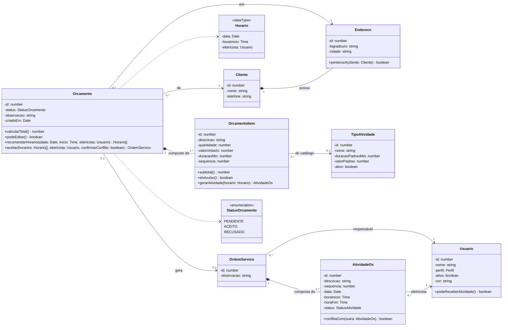

# Diagrama de classe – Aceitar orçamento

Recorte da [[Classe - Geral]] com o que participa de `POST /orcamentos/:id/aceitar` (`orcamento.service.aceitar`).

`aceitar` gera uma `AtividadeOs` por item (`gerarAtividade`). Se houver conflito e `confirmarConflito` for falso, o aceite é recusado (409) e nada é gravado; com confirmação, grava e devolve o aviso (RN 68).
