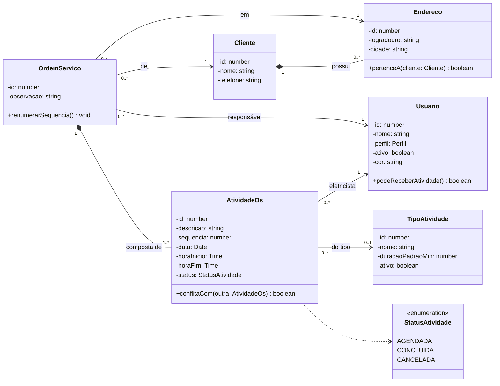

# Diagrama de classe – Criar OS

Recorte da [[Classe - Geral]] com o que participa de `POST /os` (`os.service.criar`).

Na criação, toda atividade nasce `AGENDADA`; conflito de horário (`conflitaCom`) só gera aviso (`aviso_conflito`), não bloqueia.
