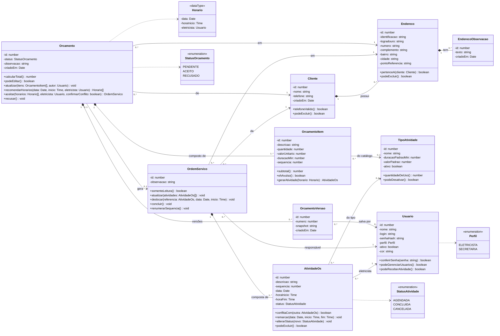

# Diagrama de classe – visão geral do domínio

Métodos representam regras de negócio; na implementação ficam nos services do backend (`server/services/`), não nos models. Atributos seguem o dicionário de dados, com chaves estrangeiras mostradas como relacionamentos.

## Onde cada método está no código

| Método | Implementação | Regra |
|---|---|---|
| `Orcamento.calcularTotal()` | `orcamento.service` → `totalDe` | RN 48 |
| `Orcamento.podeEditar()` | `orcamento.service` → `garantirPendente` | RN 54 |
| `Orcamento.atualizar()` | `orcamento.service.atualizar` (grava `OrcamentoVersao` antes) | RF 4.18 |
| `Orcamento.recomendarHorarios()` | `orcamento.service.recomendarHorarios` → `recomendacao.recomendar` | RF 4.19, RN 67 |
| `Orcamento.aceitar()` | `orcamento.service.aceitar` (conflito sem confirmação → 409) | RN 51, RN 68 |
| `Orcamento.recusar()` | `orcamento.service.recusar` | — |
| `OrcamentoItem.subtotal()` / `ehAvulso()` / `gerarAtividade()` | dentro de `totalDe` e `aceitar` | — |
| `OrdemServico.somenteLeitura()` | `os.service.atualizar` (sem atividade agendada → 409) | RN 9 |
| `OrdemServico.atualizar()` | `os.service.atualizar` (cria, altera e remove atividades) | P6.4, P6.8 |
| `OrdemServico.deslocar()` | `os.service.deslocar` | P6.2 |
| `OrdemServico.concluir()` | `os.service.concluir` | P6.6 |
| `OrdemServico.renumerarSequencia()` | `os.service.atualizar` / `excluirAtividade` | RN 35 |
| `AtividadeOs.conflitaCom()` | `agenda.service.idsEmConflito` | RN 10 |
| `AtividadeOs.remarcar()` | `os.service.remarcarAtividade` | P6.3 |
| `AtividadeOs.alterarStatus()` | `os.service.alterarStatus` (agendada → concluída/cancelada) | P6.6 |
| `AtividadeOs.podeExcluir()` | `os.service.excluirAtividade` (só concluída/cancelada) | RN 14, RN 15 |
| `Cliente.telefoneValido()` | `cliente.service` → `validarTelefone` (DDD + 8/9 dígitos, único) | — |
| `Cliente.podeExcluir()` | `cliente.service.excluir` (bloqueia se houver OS) | — |
| `Endereco.pertenceA()` | `os.service.validarClienteEndereco` | RN 34 |
| `Endereco.podeExcluir()` | `endereco.service.excluir` (bloqueia se houver OS) | — |
| `TipoAtividade.quantidadeDeUso()` | `tipoAtividade.service.contarUso` | — |
| `TipoAtividade.podeDesativar()` | `tipoAtividade.service` → `garantirOutroAtivo` (não desativa o último ativo) | RF 5.6 |
| `Usuario.conferirSenha()` | `auth.service.entrar` (bcrypt) | P2.1 |
| `Usuario.podeGerenciarUsuarios()` | middleware `somenteSecretaria` | — |
| `Usuario.podeReceberAtividade()` | `os.service.validarEletricistas` (perfil eletricista e ativo) | RN 63 |

O fim sugerido da atividade (duração padrão do tipo, RN 2) é calculado só no front (`fimPara` em `client/src/agenda/OsForm.jsx`), por isso não aparece como método.
